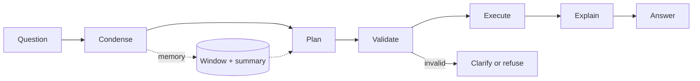
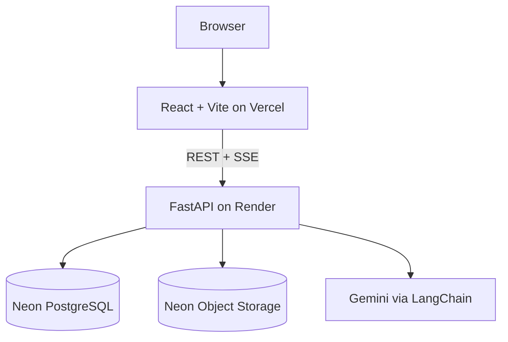

# AI Data Analyst

Upload a CSV, ask questions about it in plain language, and get the answer as a table, a chart and a sentence.

**Live demo:** https://frontend-nine-flax-87.vercel.app

The backend runs on a free Render instance that sleeps after 15 minutes idle, so the first request may take about a minute while it wakes. Everything after that is fast.

## What it does

- **Upload a CSV and see what was wrong with it.** Every file is checked for missing values, duplicate rows and unusable columns before any question is allowed; a file that is more than 40% empty is refused with the reason.
- **Ask in plain language.** "Which product has the highest total quantity sold?" — no formulas, no query language.
- **Get a table and a chart, not just a sentence.** The figure that answers the question is highlighted in the sentence and in the chart.
- **Ask follow-up questions.** "Now show it per month" and "Only 2024 from now on" work, because the conversation is condensed and remembered.
- **Watch the answer being worked out.** The stages, the result and the explanation stream in over SSE as they happen.
- **Get told when it cannot help.** An ambiguous question gets a clarifying question back; one outside the five supported operations is refused, with suggestions of what it can answer instead.
- **Try it without a file of your own.** Three sample datasets are built in, including a deliberately messy one that gets rejected.

## How a question is answered



A real two-turn exchange on `samples/orders.csv`:

1. **"Only 2024 from now on"** — the condenser classifies this as an instruction rather than a question, so no analysis runs. It is acknowledged and stored.
2. **"What is the total revenue per country?"** — the condenser rewrites it against the conversation as *"What is the total revenue per country in 2024?"*.
3. **Plan.** The model returns a plan, not code: filter rows where `OrderDate_year` equals 2024, group by `Country`, sum `Revenue`, sort descending.
4. **Validate.** Every column must exist and be usable, and every operation must suit the column's type — `sum` on a text column is rejected before anything runs.
5. **Execute.** The plan runs against the stored Parquet file with pandas. No model-written code is ever executed.
6. **Explain.** The result is summarised in one sentence: **Germany, with 617,940 in revenue.** Without the 2024 instruction the same question returns 1,051,028 for Germany, which is the whole two-year total.

## Architecture



- **Frontend** — React 19 and Vite, deployed on Vercel. It holds no analysis logic; it renders what the API sends.
- **Backend** — FastAPI on Render. It owns validation, execution and the conversation.
- **PostgreSQL** — Neon. Sessions, datasets, column metadata, conversations, messages and the rolling summary.
- **Object storage** — Neon's S3-compatible store. The cleaned dataframe is kept as Parquet, so types survive a restart.
- **Model** — Gemini through LangChain, used for three things only: condensing the question, planning the analysis, and writing the final sentence.

## Key design decisions

| Decision | Why |
|---|---|
| The model plans; it never runs code | A plan is five whitelisted pandas operations with validated arguments. Generated code would be arbitrary execution on the server. |
| Validate the plan before executing it | Columns must exist and be available, and the operation must suit the type. `sum` on a text column would silently concatenate strings. |
| Memory is a 3-exchange window plus a rolling summary | Replaying the whole conversation grows the prompt without bound. The summary is what lets "only 2024" survive leaving the window. |
| Condense the question before planning | One rewritten question is cheaper and more reliable to plan against than a transcript, and it is shown to the user as "Understood as". |
| Stream over SSE, with the turn in a background task | The answer appears as it is produced, and a client that disconnects mid-turn still gets its reply saved. |
| Parquet in object storage, not CSV | Parsing CSV on every question would re-infer types each time. Parquet keeps the dtypes the quality checks decided on. |

## Tech stack

- **Frontend** — React 19, Vite, Tailwind CSS 4, Recharts, lucide-react
- **Backend** — Python 3.14, FastAPI, Pydantic v2, Uvicorn
- **AI** — Google Gemini via `langchain-google-genai`; two model tiers, a stronger one for planning and a fast one for condensing and explaining, each with a fallback chain
- **Data** — pandas, PyArrow, SQLAlchemy 2 (async) with asyncpg, Alembic, Neon PostgreSQL, Neon Object Storage via boto3
- **Deployment** — Vercel (frontend), Render (backend)

## Run locally

Prerequisites: Python 3.14, Node 20 or newer, a Neon project (PostgreSQL + object storage) and a Google AI Studio API key.

**Backend**

```bash
cd backend
python -m venv ../.venv

# macOS/Linux
source ../.venv/bin/activate
# Windows
..\.venv\Scripts\activate

pip install -r requirements.txt
cp .env.example .env          # Windows: copy .env.example .env
# fill in .env, then apply the schema
alembic upgrade head
uvicorn app.main:app --reload --port 8000
```

`http://127.0.0.1:8000/health` should return `{"status":"ok","database":"ok","storage":"ok",...}`, and the API docs are at `/docs` outside production.

**Frontend**

```bash
cd frontend
npm install
cp .env.example .env          # Windows: copy .env.example .env
npm run dev                   # http://localhost:5173
```

### Environment variables

Names only — real values belong in `.env`, which is ignored by git. See `backend/.env.example` and `frontend/.env.example` for the full list with defaults.

| Name | Purpose |
|---|---|
| `DATABASE_URL` | Neon pooled connection string, used by the app |
| `DATABASE_URL_DIRECT` | Neon direct connection string, used by Alembic only |
| `AWS_ENDPOINT_URL_S3` | Neon Object Storage endpoint |
| `AWS_ACCESS_KEY_ID` / `AWS_SECRET_ACCESS_KEY` | Object storage credentials |
| `AWS_REGION` | Object storage region |
| `NEON_STORAGE_BUCKET` | Bucket holding the Parquet files |
| `GEMINI_API_KEY` | Google AI Studio key |
| `CORS_ALLOWED_ORIGINS` | Comma-separated frontend origins |
| `ENVIRONMENT` | `development` or `production`; production hides `/docs` |
| `LLM_DEV_CACHE` | Caches model replies on disk while developing; must be off in production |
| `VITE_API_BASE_URL` | Frontend only: the backend's URL, baked in at build time |

## Tests

```bash
cd backend
pytest                      # all 480
pytest tests --ignore=tests/api   # the 397 that need no database
```

The 397 unit tests cover plan validation, the pandas tools, condensation, the rolling summary, SSE framing, the model fallback chain and the sample data. The 83 API tests drive the real endpoints with `httpx`; the model is always mocked, so no test spends API quota.

API tests create their own PostgreSQL schema and redirect every table into it with SQLAlchemy's `schema_translate_map`, so they never touch the data in `public`.

## Limitations

- **Free-tier quota.** Google's free tier allows 20 requests per model per day. A question costs one planning call and two fast calls, and each role falls back through several models, so roughly 30 questions a day before the chain is exhausted.
- **Five operations.** Filter, aggregate, sort, limit and select columns. There is no forecasting, no arithmetic between columns, and no statistics such as correlation.
- **Your data is tied to this browser.** There are no accounts. A session id in `localStorage` owns your datasets; clear it and they are unreachable.
- **Uploads are capped** at 5 MB and 100,000 rows, with up to 20 datasets per session.
- **Cold start.** The free Render instance sleeps after 15 minutes idle and takes 30 to 60 seconds to wake.

## Roadmap

- Derived columns, so questions like "profit per country" can be answered from revenue and cost.
- A second analysis pass for follow-ups that only re-filter an existing result, to avoid spending a planning call.
- Export of a result as CSV, and of a conversation as a short report.
- Optional accounts, so a workspace survives clearing the browser.

## Project structure

```
backend/
  app/
    agent/      planner, validators, explainer, model client
    api/        routers, serializers, SSE, error envelope
    data/       CSV loading, quality checks, Parquet store
    db/         SQLAlchemy models and session
    services/   datasets, conversations, condenser, summarizer, analysis
  alembic/      migrations
  tests/        480 tests; tests/api needs a database
frontend/
  src/
    api/        REST client, SSE client, session id
    components/ screens and the shared answer card
    lib/        question templates, result shaping, formatting
samples/        orders.csv, customers.csv, bad.csv
docs/           PLAN.md (design), API_CONTRACT.md (every endpoint)
```
